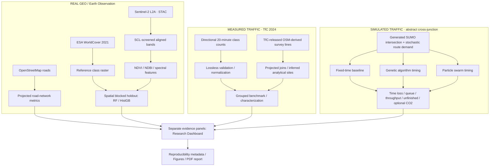

# UrbanTwin-AI

**Geospatial Intelligence & Traffic Optimization for Sustainable Cities**

[](https://www.python.org/) [](LICENSE) [](#research-status-and-honesty)

> **Research question:** How can real Earth observation, measured directional traffic demand and reproducible counterfactual simulation be studied together without confusing measured, mapped, inferred and simulated evidence?

**Author:** Roaa Raafat · B.Sc. Data Science & Artificial Intelligence · Zewail City of Science and Technology

A modular research prototype integrating:

- **Real geospatial context** around Tahrir Square, Cairo: validated Sentinel-2 L2A 2021 and near-survey 2024 bundles, ESA WorldCover 2021 historic reference labels, georeferenced maps, NDVI and NDBI.
- **ML evaluation:** Random Forest vs Histogram Gradient Boosting, spectral feature ablation, repeated grouped spatial splits, per-class confusion matrices, and explicit unsupported-class reporting **against WorldCover pseudo-labels**.
- **Measured traffic analysis:** actual TfC 2024 directional 20-minute link counts, lossless normalization, inferred-site grouping, frozen joint future-date/unseen-site evaluation and separate online persistence.
- **Traffic simulation:** a completed, explicitly abstract SUMO fixed-time/GA/PSO/equal-budget random-search comparison. It is not observed Cairo demand.
- **Visualization and research outputs:** Streamlit dashboard, plots, machine-readable provenance, research-report PDF generator.

**IMPORTANT:** The default SUMO intersection is **abstract and synthetic**, **not a calibrated simulation of Tahrir Square**, and its traffic demand is generated independently of satellite imagery. The geospatial and mobility findings are adjacent research components, not a validated causal relationship. A SUMOFlow external network adapter is included only for compatible two-green-phase signal programs and matching prebuilt vehicle-route files.

## Research status and honesty

The primary-source audit is documented in [docs/real_data_feasibility.md](docs/real_data_feasibility.md); the executed measured study is documented in [docs/observed_traffic_case_study.md](docs/observed_traffic_case_study.md). TfC's public directional link counts and surveyed lines support observed-demand characterization and a bounded prediction prototype. They do **not** supply turning movements, complete routes or observed signal timing, so the measured-demand signal phase is deliberately **not run**.

Validated measured-study outputs carry the explicit provenance label
`real_observed_traffic_analysis`; this label is never applied to the separate synthetic SUMO
experiment.

| Component | Verified local status | How to validate |
|---|---|---|
| 2021 real EO and repeated grouped WorldCover agreement | Executed and provenance-valid locally | `urbantwin status` |
| Near-survey 2024 Sentinel-2 context | Executed locally; WorldCover remains historic 2021 reference | `urbantwin observed-eo-fetch` for a new directory |
| TfC measured traffic ingestion and benchmark | Executed: 6,618 intervals / 2,961,483 vehicles | `urbantwin observed-study --resume` |
| Current OSM study-area context | Validated: 849 nodes / 1,788 directed edges; current third-party map context | Inspect `data/observed/osm/current_tahrir/road_manifest.json` |
| Full abstract SUMO comparison | Executed: 198 logical requests / 162 physical runs / 36 cache hits; synthetic network/demand | `urbantwin status` |
| Dashboard and observed research PDF | Executed locally from strictly validated artifacts | See commands below |
| Measured-demand Cairo signal optimization | **NOT RUN — scientifically blocked** | Needs movements, routes and signal observations |
| Calibrated Cairo digital twin / deployed controller | **NOT CLAIMED** | Requires independent calibration and validation |

Generated experiment bundles are Git-ignored because they are machine-specific, may be large and may contain source-derived material whose redistribution is unresolved. The working copy can contain verified results without shipping them as pre-filled repository evidence. Synthetic demo scores remain software fixtures and must never be cited as scientific findings.

## Architecture



## Quickstart (Windows PowerShell 5.1 / Python 3.12)

**1. Download this repository ZIP, extract to a local folder, and open PowerShell inside the extracted `UrbanTwin-AI` folder.** You do not need to clone or modify a private repository first.

```powershell
cd "D:\UrbanTwin-AI"   # CHANGE to wherever you extracted the ZIP
py -3.12 -m venv .venv
.\.venv\Scripts\Activate.ps1
python -m pip install --upgrade pip
python -m pip install -e ".[all]"
python -m pytest -q
python scripts/verify_release.py
```

If PowerShell blocks activation, use `.\.venv\Scripts\python.exe` in place of `python`, or run `Set-ExecutionPolicy -Scope Process Bypass` for your current session only. The package will install geospatial wheels, Streamlit, PySTAC, TraCI and testing tools; internet access is necessary for first installation.

If `python` resolves to a different interpreter after activation, check `python -c "import sys; print(sys.executable)"`. Prefer a current 64-bit CPython release with binary wheels; building Rasterio or GeoPandas from source requires a separate native GDAL toolchain. A missing `sumo.exe` or `netconvert.exe` is not fixed by installing the Python `traci` package—install Eclipse SUMO and verify both executables explicitly. Network/STAC/Overpass failures stop real-mode commands; they never trigger a synthetic fallback.

**2. Run the OFFLINE unit tests, followed by a synthetic-data pipeline sanity check.**

```powershell
python -m pytest -q
urbantwin demo
urbantwin status
```

The `demo` command saves **only synthetic** data in `data/synthetic/` and synthetic scores in `results/demo/`. Its classification scores can be very high because the data were deliberately generated from simple patterns. Never use those scores in your academic CV.

**3. Download REAL satellite and reference-label data.** This may take time and requires an internet connection.

```powershell
urbantwin eo-fetch
urbantwin geo-train
```

Read `data/real/provenance.json` for the actual STAC item IDs, dates, coordinate system and acquisition metadata. The project takes a small AOI and caps pixels at 400,000 to avoid large accidental downloads.

**4. Retrieve actual OpenStreetMap road geometry.**

```powershell
urbantwin roads
```

This downloads the driving-road network for the bounding box (not a historical snapshot), exports `data/osm/roads.geojson`, and reports road density in projected meters per km². Be respectful of Overpass request rate limits. OSM road metadata and WorldCover are not necessarily from the same year.

**5. Acquire and validate the official TfC files, then run the observed study.**

The audited official records are [TfC Traffic Counts, record 190](https://data.transportforcairo.com/catalogue/#/document/190) and [TfC Traffic Survey Locations, record 193](https://data.transportforcairo.com/catalogue/#/dataset/193). TfC did not state an explicit reuse license on these records. The commands below keep source and derived row-level files under Git-ignored `data/observed/`; do not redistribute them until TfC confirms reuse terms.

PowerShell 5.1 can download the two small official archives directly. For a manual browser download,
open the two official record pages above, choose their download action, and save the files exactly as
`data\observed\source\tfc_2024_traffic_counts.zip` and
`data\observed\source\tfc_2024_traffic_survey_locations.zip`. These commands open the authoritative
records rather than a third-party mirror:

```powershell
Start-Process "https://data.transportforcairo.com/catalogue/#/document/190"
Start-Process "https://data.transportforcairo.com/catalogue/#/dataset/193"
```

For the verified anonymous-download path, use:

```powershell
$repo = (Resolve-Path ".").Path
$sourceDir = Join-Path $repo "data\observed\source"
New-Item -ItemType Directory -Force $sourceDir | Out-Null
$counts = Join-Path $sourceDir "tfc_2024_traffic_counts.zip"
$locations = Join-Path $sourceDir "tfc_2024_traffic_survey_locations.zip"

Invoke-WebRequest -UseBasicParsing `
  -Uri "https://data.transportforcairo.com/api/v2/assets/252/download" `
  -OutFile $counts
Invoke-WebRequest -UseBasicParsing `
  -Uri "https://data.transportforcairo.com/api/v2/assets/255/download" `
  -OutFile $locations
$retrievedAtUtc = (Get-Date).ToUniversalTime().ToString("yyyy-MM-ddTHH:mm:ssZ")

(Get-FileHash -Algorithm SHA256 $counts).Hash.ToLower()
# Expected: d90703a022b2cad08e0533a4d9538236e45034c2fe260673a08c6995a56bbd7b
(Get-FileHash -Algorithm SHA256 $locations).Hash.ToLower()
# Expected: d8b8e329be14b2c008460e7caed55c3dc820dc151119f4d0d37fa4a6070b42b1

urbantwin observed-data-audit --counts $counts --locations $locations
urbantwin observed-data-prepare `
  --counts $counts `
  --locations $locations `
  --source-retrieved-at-utc $retrievedAtUtc
```

Preparation writes `data/observed/tfc/normalized_v1/` atomically and refuses to overwrite an inspected bundle. It preserves 6,618 interval rows, 79,416 class rows, missing values, undefined direction semantics, five OSM-ID conflicts and the source checksums. The released “60 locations” have no official location key; the analysis uses reproducible 250 m geometry connected components and labels all 60 groups as inferred.

The independent current-OSM context already validated under
`data/observed/osm/current_tahrir/` contains 849 nodes and 1,788 directed edges in EPSG:32636. It
has three weak components; the largest contains 847 nodes (99.764%). Both selected AOI survey lines
have reliable OSM-ID-plus-geometry matches. Their legal routing direction is still unverified because
TfC does not define the semantics of direction codes `0` and `1`. The bundle is attributed to
OpenStreetMap contributors under ODbL 1.0 and is current third-party map data, not a 2024 traffic
measurement or a simulation-ready signal network.

To reproduce that road bundle into a new, non-existing directory, use the bounded Overpass workflow
below. It caches provider responses and refuses to overwrite prior evidence. If Overpass is
unavailable, `--pbf` accepts an independently downloaded Geofabrik Egypt extract, but that fallback
is deliberately labeled geometry-only rather than a routable graph.

```powershell
urbantwin observed-roads `
  --output-dir "data\observed\osm\current_tahrir_reproduction"

# Optional offline geometry-only fallback:
urbantwin observed-roads `
  --output-dir "data\observed\osm\geofabrik_geometry_reproduction" `
  --pbf "D:\path\to\egypt-latest.osm.pbf"
```

Fetch the separate near-survey EO context and run the bounded study. `observed-eo-fetch` writes only to `data/observed/eo_2024/` and cannot replace `data/real/`. The three verified Sentinel-2 L2A scenes are dated 24 October, 29 October and 3 November 2024; WorldCover 2021 remains a historic reference product.

```powershell
urbantwin observed-eo-fetch
python -m pip install -e ".[mlflow]"
urbantwin observed-study --resume --mlflow
urbantwin observed-report
```

The two observed-study notebooks are deliberately stored without outputs. Install the optional
notebook environment and open them only after the validated local bundles above exist:

```powershell
python -m pip install -e ".[notebooks]"
jupyter lab notebooks\03_observed_traffic_measurements.ipynb `
  notebooks\04_observed_traffic_benchmark.ipynb
```

The frozen final split uses the last six survey dates and ten unseen inferred sites: 5,255 training
rows from 50 inferred sites and 1,207 holdout rows, with zero site overlap. Five ambiguous OSM joins
(156 rows) are excluded from the primary benchmark. Under the measurement-free information budget,
combined-feature histogram gradient boosting has the lowest MAE point estimate: 348.25 vehicles per
20 minutes (95% site-bootstrap interval 239.46–487.46), with RMSE 496.34 (309.46–654.29).
Online persistence is evaluated on 1,170 exactly adjacent intervals and has MAE 63.93 and RMSE 144.04,
but it consumes the preceding measured count. It is therefore a different online task, not a fair
head-to-head baseline. The compatible local MLflow record is experiment
`UrbanTwin-Observed-Traffic`, run `108df19c55d445ea8e53b0c85abbb4ce`.

Local observed-study storage is deliberately separate:

- official downloads and normalized tables: `data/observed/`;
- near-survey EO: `data/observed/eo_2024/`;
- validated observed outputs: `results/observed_traffic/`;
- observed PDF and hash sidecar: `output/pdf/`;
- optional SQLite tracking and artifacts: `.urbantwin/mlflow/`.

The measured-demand SUMO phase is **NOT RUN**. Although the current road graph and both selected
line matches are valid for GIS context, link counts do not identify routing direction, turning
movements, complete routes, signal phases/timing, pedestrians or driver parameters, and the selected
6th of October Bridge pair is not a verified signalized intersection.

**6. Install SUMO separately** (Python `traci` does **not** install the SUMO simulation executable).

Get Eclipse SUMO from https://eclipse.dev/sumo/ . Install Windows binaries, then make `sumo.exe` and `netconvert.exe` accessible on `PATH`, or set `SUMO_HOME` to the installation directory. Confirm:

```powershell
sumo --version
netconvert --version
```

**7. Run a very small SUMO executable smoke test, then the full configured simulation.**

```powershell
urbantwin traffic-run --quick --resume
# After the quick run executes correctly, run the configured multi-scenario benchmark:
urbantwin traffic-run --resume
```

The quick mode runs small optimizer populations and records its results **separately** in `results/traffic_quick/`; it is not a meaningful optimization study. With the checked-in configuration, a full run schedules 198 logical SUMO requests: `3 scenarios × (3 optimizers × 18 objective evaluations × 1 training seed + 4 methods × 3 evaluation seeds)`. Repeated integer plans can reduce the physical execution count through validated cache reuse, but never reduce an optimizer's declared evaluation budget. You can adjust population, generations and evaluation seeds in `configs/experiments.yaml`. Keep all tested methods, routes and split seeds consistent. The verified local full run under SUMO 1.26.0 completed all 198 logical requests through 162 physical executions and 36 cache hits. Its ignored local artifacts remain the evidence; the quick smoke test alone never establishes completion or performance.

Every successful unique SUMO simulation is saved atomically under `.urbantwin/checkpoints/traffic/`, independently of the final research tables in `results/traffic/`. Checkpoint identity binds the configuration, network, route, SUMO version, scenario, seed, signal plan, emissions settings and simulation settings. `--resume` reuses only complete, compatible, checksum-validated entries; missing, stale, corrupt or incompatible entries are recomputed. Pressing Ctrl+C may stop the current simulation, but it does not delete checkpoints already completed. Run the same command again with `--resume`. Progress is printed while the benchmark runs and identifies the scenario, method, objective-evaluation number, processed versus estimated SUMO requests, newly executed simulations, cache hits and elapsed time. Repeated integer plans can make the physical run count smaller than the estimate without changing any optimizer budget.

To place checkpoints elsewhere, pass an explicit local directory:

```powershell
urbantwin traffic-run --resume --checkpoint-dir "D:\UrbanTwin-cache\traffic"
```

Do not edit checkpoint JSON by hand or copy entries between incompatible experiments. To safely clear only the default traffic checkpoints, first stop any running benchmark, then use this guarded PowerShell 5.1 command. Final result CSVs and MLflow data are not removed; the next run must recompute the cleared simulations.

```powershell
$repo = (Resolve-Path ".").Path
$checkpointRoot = [System.IO.Path]::GetFullPath((Join-Path $repo ".urbantwin\checkpoints"))
$trafficCheckpoints = [System.IO.Path]::GetFullPath((Join-Path $checkpointRoot "traffic"))
if (-not $trafficCheckpoints.StartsWith(
    $checkpointRoot + [System.IO.Path]::DirectorySeparatorChar,
    [System.StringComparison]::OrdinalIgnoreCase
)) { throw "Refusing to remove a path outside the checkpoint root." }
if (Test-Path -LiteralPath $trafficCheckpoints) {
    Remove-Item -LiteralPath $trafficCheckpoints -Recurse -Force
}
```

#### Optional MLflow tracking

Checkpointing never requires MLflow. To add experiment tracking, install the separate optional extra and run the benchmark with both flags:

```powershell
python -m pip install -e ".[mlflow]"
urbantwin traffic-run --mlflow --resume
```

The default tracking store is the local SQLite database `.urbantwin/mlflow/mlflow.db`, with local artifacts below `.urbantwin/mlflow/artifacts/`. Both locations are ignored by Git. Abstract SUMO runs are organized in `UrbanTwin-Traffic-Optimization`; the measured study uses the separate `UrbanTwin-Observed-Traffic` experiment. The current compatible observed run is `108df19c55d445ea8e53b0c85abbb4ce`. Individual SUMO executions are not turned into thousands of MLflow runs. The authoritative recovery mechanism remains `.urbantwin/checkpoints/traffic/`, and the authoritative final bundles remain the provenance-checked local result files. MLflow records only validated outputs and clearly labels modeled SUMO CO₂ as simulator-only—not observed environmental data.

To use another tracking server or database, pass its URI explicitly or set `MLFLOW_TRACKING_URI` before the command. The explicit CLI value takes precedence:

```powershell
$env:MLFLOW_TRACKING_URI = "http://127.0.0.1:5000"
urbantwin traffic-run --mlflow --resume

# Equivalent explicit form:
urbantwin traffic-run --mlflow --resume `
  --mlflow-tracking-uri "http://127.0.0.1:5000"
```

For the default local store, open the MLflow UI from the repository root with:

```powershell
$repo = (Resolve-Path ".").Path
$dbPath = (Join-Path $repo ".urbantwin\mlflow\mlflow.db").Replace('\', '/')
$artifactPath = (Join-Path $repo ".urbantwin\mlflow\artifacts").Replace('\', '/')
mlflow ui `
  --backend-store-uri "sqlite:///$dbPath" `
  --default-artifact-root "file:///$artifactPath" `
  --host 127.0.0.1 `
  --port 5000
```

Then visit `http://127.0.0.1:5000`. MLflow logging is post-computation and cannot replace or invalidate validated local SUMO results. If tracking fails, the command reports that failure explicitly while retaining the local checkpoints and final artifacts.

**8. Display the separated evidence dashboard and generate provenance-checked reports.**

```powershell
streamlit run src/urbantwin/visualization/dashboard.py
urbantwin observed-report
urbantwin report
```

The dashboard keeps observed EO, observed traffic, the blocked measured-demand phase and abstract
simulation in separate sections. The observed report is saved as
`output/pdf/urbantwin_observed_traffic_study.pdf` with a matching provenance sidecar; it accepts only
the strictly validated observed bundle. The separate abstract/GeoAI report is saved as
`reports/generated_research_report.pdf` and also requires matching metrics, source data,
configuration, timestamps and recorded SHA-256 hashes. If you want an **explicitly labeled
methodology-only PDF** that consumes no experiment files:

```powershell
urbantwin report --draft
```

Draft mode never consumes experiment files, even if they are present. The tracked
`reports/research_report.pdf` is a methodology-only historical artifact; use the generated observed
report and its provenance sidecar when citing the measured study.

## Exact repository file layout

```text
UrbanTwin-AI/
├── .env.example
├── .gitignore
├── LICENSE
├── README.md
├── pyproject.toml
├── requirements.txt
├── Makefile
├── configs/
│   ├── study_area.yaml
│   ├── experiments.yaml
│   ├── observed_eo_2024.yaml
│   └── observed_traffic.yaml
├── src/urbantwin/
│   ├── cli.py
│   ├── common.py
│   ├── data/
│   │   ├── earth_observation.py
│   │   ├── spatial_features.py
│   │   ├── observed_traffic.py
│   │   ├── observed_study.py
│   │   └── demo.py
│   ├── observed/
│   │   ├── features.py
│   │   ├── roads.py
│   │   ├── benchmark.py
│   │   ├── artifacts.py
│   │   ├── mlflow_tracking.py
│   │   └── report.py
│   ├── geoai/
│   │   ├── train.py
│   │   └── evaluate.py
│   ├── traffic/
│   │   ├── network.py
│   │   ├── baselines.py
│   │   ├── optimize.py
│   │   ├── benchmark.py
│   │   ├── checkpoints.py
│   │   └── mlflow_tracking.py
│   └── visualization/
│       ├── plots.py
│       ├── dashboard.py
│       └── report_writer.py
├── notebooks/
│   ├── 01_geospatial_analysis.ipynb
│   ├── 02_experiment_results.ipynb
│   ├── 03_observed_traffic_measurements.ipynb
│   └── 04_observed_traffic_benchmark.ipynb
├── docs/
│   ├── real_data_feasibility.md
│   ├── observed_traffic_case_study.md
│   └── portfolio_summary.md
├── scripts/
│   └── verify_release.py
├── results/
│   ├── README.md
│   └── figures/.gitkeep
├── reports/
│   ├── research_report.md
│   └── research_report.pdf  # methodology only, no claimed results
└── tests/
```

## Data methods

### Coordinate reference system and spatial validity

The study area is defined as `[west, south, east, north]` in WGS84. Raster bands and WorldCover tiles are reprojected onto an identical 10 m raster grid in **EPSG:32636 (UTM 36N)** for the Cairo AOI. Cloud screening uses Sentinel-2 Scene Classification Layer (SCL) classes 4, 5, 6 and 7; selected scene-level cloud cover is an additional filter, not a guarantee of cloud-free study pixels. Pixel-wise median across selected scenes is computed only on nonmasked observations. Data source timestamps and item IDs are in `data/real/provenance.json`.

Indices use `(NIR − Red)/(NIR + Red)` for NDVI and `(SWIR − NIR)/(SWIR + NIR)` for NDBI; divide-by-zero outputs are NaN. Missing bands/cloudy pixels are excluded. Percentages are computed on the valid Sentinel-WorldCover overlap and the represented area is explicitly reported.

### WorldCover reference-label study, not ground-truth survey

The 2021 ESA WorldCover raster is the label source and therefore the evaluation target. Classifier macro-F1 measures **agreement with WorldCover**, not independent physical land-cover accuracy. Models are evaluated across repeated group-disjoint spatial splits rather than independent random pixels. Eligibility is decided from training support only; test labels are never consulted to cherry-pick classes. The output records every WorldCover class excluded for insufficient training support, while test-unsupported eligible classes remain in the declared label set and score as zero when appropriate. Per-split support and confusion matrices are retained. Because nearby blocks remain spatially correlated, the numbers should not be interpreted as cross-region generalization.

### Traffic baseline and fairness

The generated network is a one-junction, four-approach, one-lane-per-direction **synthetic** SUMO network. The default four route directions go straight across the intersection. GA, PSO and equal-budget random search each tune the durations (in seconds) of **two detected main green phases**, keeping the network's existing yellow and other phases intact. A controller with a more complex traffic light requires a dedicated, verified phase adapter; unsupported programs raise an error.

Demand is independently generated for low/medium/high scenarios with Poisson sampled counts and randomized departure times. A **fixed random seed** fixes vehicle demand so every controller sees the same scenarios. Optimizers train on separate seeds from the final comparison, use comparable objective-call budgets, and are summarized by paired evaluation seed. The objective used for *tuning*, not scientific ranking, is:

```
mean completed-trip time loss (s) + 2 × mean approach queue (vehicles) + 2 × unfinished vehicles
```

This is a deliberately simple, scale-dependent heuristic; the report compares individual KPIs rather than claiming the scalar objective is universally meaningful. Outputs distinguish **generated**, **inserted**, **completed**, **unfinished**, and **pending-to-insert** vehicles. Completed-trip `timeLoss`, waiting time and throughput are labeled so they are not confused with demand-level completion or insertion fractions. The default `track_emissions: true` integrates SUMO's per-vehicle CO₂ rate over each simulation step using the explicit generated-car class `HBEFA3/PC_G_EU4`; external routes must declare every used emissions class. This is a simulator-only model estimate, not measured Cairo air pollution, and is reported alongside completion counts to expose censoring.

### Integrating your existing SUMOFlow network (advanced)

Do not substitute your SUMOFlow network and immediately claim this is a Tahrir digital twin. First confirm network geometry, phases, demand, vehicle characteristics, and traffic counts. The existing `traffic-run` supports an external `.net.xml` path and matching route files generated for each scenario and seed:

```powershell
urbantwin traffic-run --network "D:\SUMOFlow\network.net.xml" `
  --routes-template "D:\SUMOFlow\routes\{scenario}_{seed}.rou.xml" `
  --tls-id "YOUR_TLS_ID"
```

Before route generation or simulation, the command checks that the external network exists, is a SUMO network, contains the requested traffic-light ID, and is paired with an explicit route template. It intentionally rejects signal programs with anything other than exactly two main green phases. A custom adapter is needed for more complex intersections. Calibrate against observed traffic counts before making any real-world interpretation.

## Application-specific portfolio framing

| Program | Emphasis |
|---|---|
| Erasmus Mundus SMACCs | Sustainable mobility, signal-optimization baselines, reproducibility |
| Copernicus Digital Earth | Sentinel-2 processing, WorldCover labels, NDVI/NDBI, cloud masks |
| GeoTech | GIS/CRS handling, georeferenced rasters, OSM network statistics |
| AISS | Responsible use of simulated outcomes for urban planning |
| Toulouse | Optimization experiment design and reliability |
| Lille Data Science | Spatial validation, ML ablation, class imbalance, error analysis |

**Safe CV bullet after running real-data experiments:**

> Developed a reproducible geospatial pipeline over a Cairo AOI using Sentinel-2 L2A, ESA WorldCover and OpenStreetMap; evaluated spatially blocked Random Forest and gradient-boosted classification and compared GA/PSO traffic-signal timing with a fixed-time SUMO baseline under controlled synthetic-demand scenarios.

Don't add numeric percentage improvements until the real simulations and statistical summaries have been generated and reviewed. Do not claim a *digital twin of Cairo* without traffic network geometry and demand calibration.

## Limitations, ethics, and data attribution

- WorldCover data are 2021 ESA labels; no 2020–2021 change detection is performed because the products use different algorithms.
- The Sentinel scenes are selected for dates within 2021 but do not necessarily match the WorldCover processing composite exactly.
- OSM data are contemporary when retrieved, not a historical 2021 street map.
- The road network and traffic simulation are not automatically linked or empirically synchronized.
- The current default signals model is an idealized straight-through intersection, not real Cairo road geometry.
- No individually identifiable GPS traces or patient data are used.
- **Data attribution:** Contains modified Copernicus Sentinel data; ESA WorldCover © ESA (CC BY 4.0); road data © OpenStreetMap contributors (ODbL). Source links: [ESA WorldCover](https://esa-worldcover.org/en/data-access), [Planetary Computer](https://planetarycomputer.microsoft.com/docs/), [OSM](https://www.openstreetmap.org/copyright), [SUMO](https://eclipse.dev/sumo/).

## License

This project's original source code is released under MIT (`LICENSE`). Source data are **not** relicensed by this code repository. Follow each dataset's own terms. Do not commit large downloaded data or unverified performance claims.
