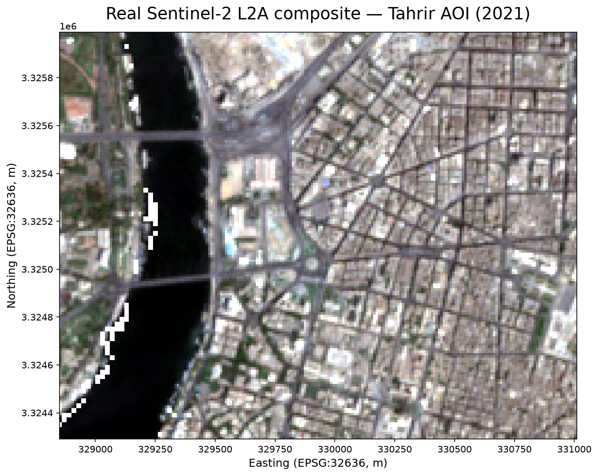
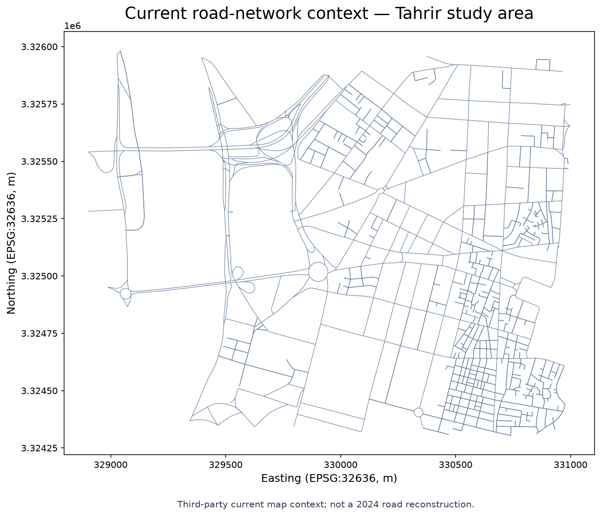
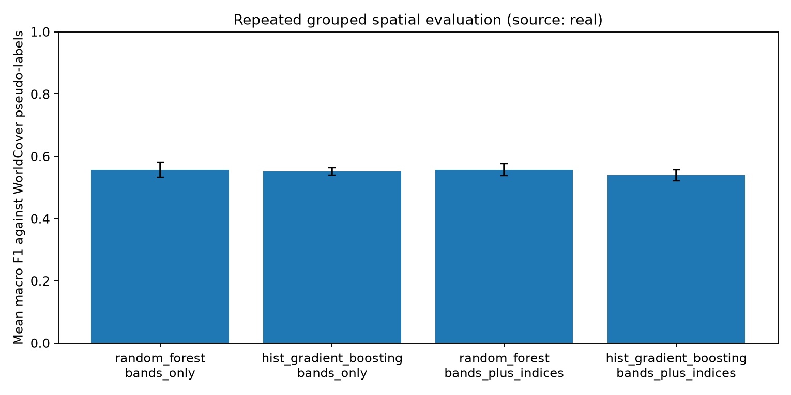
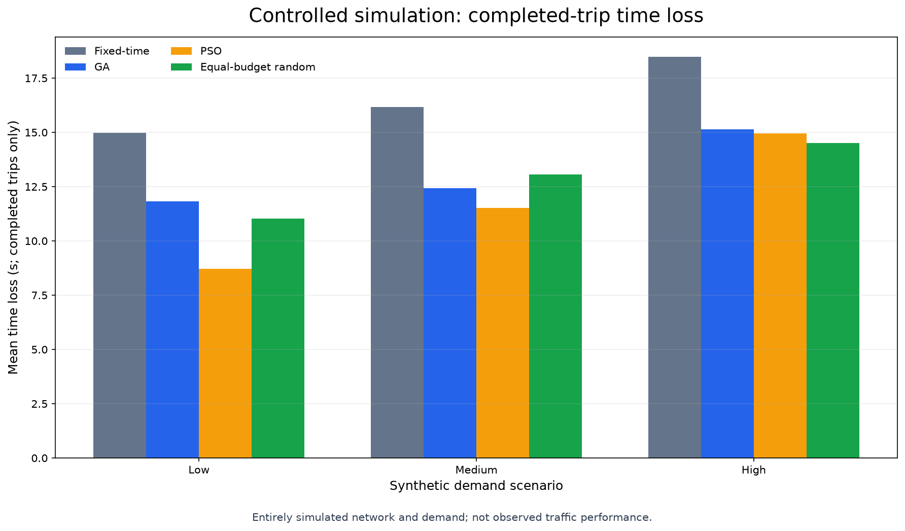
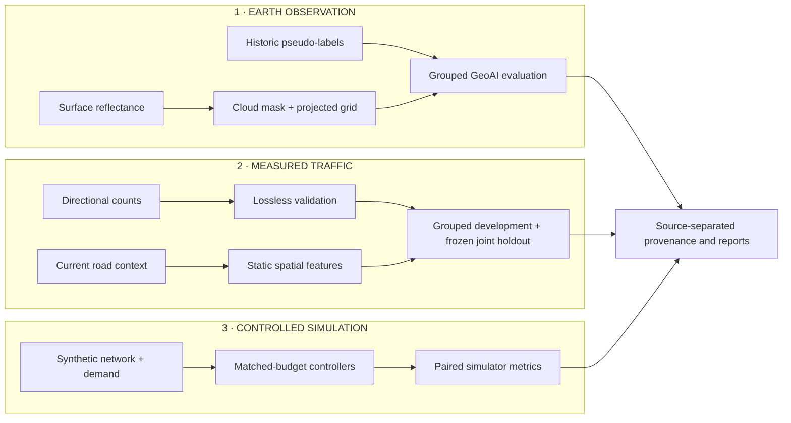

# UrbanTwin-AI

**A provenance-first research workflow for Earth observation, measured urban traffic analysis, and reproducible counterfactual signal experiments in Greater Cairo.**

UrbanTwin-AI keeps observed, remotely sensed, mapped, and simulated evidence distinct. It is a research prototype—not a deployed controller or a calibrated Cairo digital twin.

## Main research contributions

| Research stream | Completed contribution | Scientific boundary |
|---|---|---|
| **Measured traffic observations** | Lossless validation of directional 20-minute counts, projected spatial features, grouped model development, a frozen joint holdout, and site-bootstrap uncertainty | Link counts do not identify turning movements, routes, or signal timing. |
| **Earth observation and GeoAI** | Real surface-reflectance ingestion, cloud masking, 10 m projected alignment, spectral indices, class-support checks, and repeated group-disjoint evaluation | Land-cover scores measure agreement with historic pseudo-labels, not independent field accuracy. |
| **Controlled traffic simulation** | Fixed-time, evolutionary, swarm, and equal-budget random-search comparison with paired held-out seeds and reproducible provenance | The network and demand are synthetic; results are not observed Cairo traffic outcomes. |
| **Research engineering** | Source and configuration hashes, strict artifact validation, source labels, offline tests, resumable computation, dashboards, notebooks, and reports | Missing real data fails clearly; software fixtures never substitute for real observations. |

## Verified results and genuine visualizations

### Measured traffic study

The prediction protocol selects a Random Forest with combined temporal and static spatial features using grouped cross-validation on training data only. The selected configuration is evaluated once on a joint future-date/unseen-inferred-site holdout. Because each surveyed segment appears on one date, the holdout represents one combined distribution shift rather than independently proven temporal and geographic generalization.

One-step persistence is reported separately: it uses the previous measured interval and therefore has a different information budget from measurement-free estimation. Earth-observation variables are not included in this multi-site benchmark, so no accuracy gain from those variables is claimed.

### GeoAI agreement with historic pseudo-labels

Mean ± standard deviation across three repeated grouped spatial splits:

| Model | Features | Macro-F1 | Weighted-F1 | Agreement |
|---|---|---:|---:|---:|
| Random Forest | Bands | 0.5572 ± 0.0244 | 0.9211 ± 0.0023 | 0.9006 ± 0.0054 |
| Random Forest | Bands + NDVI/NDBI | 0.5573 ± 0.0195 | 0.9220 ± 0.0034 | 0.9021 ± 0.0025 |
| Histogram gradient boosting | Bands | 0.5516 ± 0.0114 | 0.9176 ± 0.0038 | 0.8973 ± 0.0021 |
| Histogram gradient boosting | Bands + NDVI/NDBI | 0.5398 ± 0.0177 | 0.9158 ± 0.0028 | 0.8948 ± 0.0022 |

These values quantify agreement with WorldCover 2021 pseudo-labels. Small differences between feature sets are descriptive and do not establish a causal or generalizable benefit from adding spectral indices.

### Controlled simulation study

Mean ± standard deviation of the paired completed-trip time-loss difference from fixed-time control across three held-out seeds; negative values are lower within this abstract simulation only.

| Synthetic demand | Genetic algorithm | Particle swarm | Equal-budget random search |
|---|---:|---:|---:|
| Low | −3.16 ± 1.65 s | −6.26 ± 1.88 s | −3.93 ± 2.00 s |
| Medium | −3.75 ± 1.52 s | −4.65 ± 0.86 s | −3.11 ± 0.58 s |
| High | −3.34 ± 1.30 s | −3.51 ± 1.05 s | −3.96 ± 0.56 s |

Three paired seeds do not establish statistical significance. Throughput and completion were unchanged in these runs; emissions are simulator-modeled estimates rather than environmental observations.

### Research outputs

<p>
  
  
</p>

*Real remotely sensed context (left) and current third-party road-network context (right). The road map is not a 2024 reconstruction.*

<p>
  
  
</p>

*Observed-source GeoAI evaluation against historic pseudo-labels (left) and an entirely simulated controller comparison (right). The two evidence streams are not combined.*

Image provenance and checksums are recorded in the [research-image manifest](docs/assets/readme/README.md).

## High-level methodology and architecture



Continuous rasters are resampled bilinearly, categorical references by nearest neighbour, and all geospatial products share an explicit projected grid. Model selection is confined to grouped training folds. Simulation optimization and evaluation seeds remain separate, and every output retains its source category.

## Technology stack

**Python 3.12** · NumPy · pandas · Rasterio · GeoPandas · scikit-learn · Matplotlib · MLflow · Streamlit · PyDeck · microscopic traffic modeling

## Minimal quickstart

Install the tested optional dependency groups, then run the complete offline checks. Live downloads and expensive simulations are not part of this validation.

```powershell
# Windows PowerShell 5.1
python -m venv .venv
.\.venv\Scripts\python.exe -m pip install --upgrade pip
.\.venv\Scripts\python.exe -m pip install -e ".[all,mlflow]"
.\.venv\Scripts\python.exe -m pytest -q
.\.venv\Scripts\python.exe -m ruff check .
.\.venv\Scripts\python.exe scripts\verify_release.py
```

```bash
# Linux or macOS
python3.12 -m venv .venv
. .venv/bin/activate
python -m pip install --upgrade pip
python -m pip install -e '.[all,mlflow]'
python -m pytest -q
python -m ruff check .
python scripts/verify_release.py
```

Environment setup, data acquisition, experiment commands, recovery procedures, and troubleshooting are in the [reproducibility guide](docs/REPRODUCIBILITY.md).

## Research documentation

- [Data sources, licensing, and attribution](docs/DATA_SOURCES.md)
- [Reproducibility guide](docs/REPRODUCIBILITY.md)
- [Measured traffic case study](docs/observed_traffic_case_study.md)
- [Evidence-bounded research case study](docs/research_case_study.md)
- [Real-data feasibility audit](docs/real_data_feasibility.md)
- [Results integrity and artifact policy](results/README.md)
- Notebooks: [geospatial analysis](notebooks/01_geospatial_analysis.ipynb), [experiment results](notebooks/02_experiment_results.ipynb), [measured observations](notebooks/03_observed_traffic_measurements.ipynb), and [model benchmark](notebooks/04_observed_traffic_benchmark.ipynb)

## Limitations and attribution

- Site and date effects are confounded because each measured segment was surveyed on one date; the holdout is one joint shift.
- Released survey geometry reflects a 2026 map extract and is retrospective for the 2024 observations.
- The 3 November 2024 scene is retrospective context for the 31 October survey and was unavailable to a prospective forecast.
- Earth observation is absent from the multi-site traffic benchmark; no predictive or causal contribution is claimed.
- WorldCover 2021 is a historic pseudo-label reference, not 2024 field ground truth.
- The controlled experiment is not a calibrated Cairo simulation, a field-validated signal improvement, an observed-CO₂ study, or a deployed controller.

Source code is MIT-licensed. Data and map products retain their original terms; see [data sources and attribution](docs/DATA_SOURCES.md) for the required acknowledgements.
