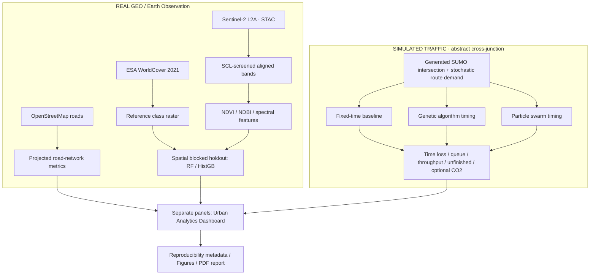

# UrbanTwin-AI

**Geospatial Intelligence & Traffic Optimization for Sustainable Cities**

[](https://www.python.org/) [](LICENSE) [](#research-status-and-honesty)

> **Research question:** Can satellite-derived land-cover information and controlled AI-based traffic-signal optimization provide a reproducible framework for analyzing urban context and simulated mobility?

**Author:** Roaa Raafat · B.Sc. Data Science & Artificial Intelligence · Zewail City of Science and Technology

A modular research prototype integrating:

- **Real geospatial context** around Tahrir Square, Cairo: Sentinel-2 L2A, ESA WorldCover 2021, OpenStreetMap road network, georeferenced maps, NDVI, NDBI.
- **ML evaluation:** Random Forest vs Histogram Gradient Boosting, spectral feature ablation, repeated grouped spatial splits, per-class confusion matrices, and explicit unsupported-class reporting **against WorldCover pseudo-labels**.
- **Traffic experiments:** SUMO fixed-time control versus GA, PSO, and equal-budget random search for two main traffic-signal green phases. The same routes and paired held-out seeds are used across controllers.
- **Visualization and research outputs:** Streamlit dashboard, plots, machine-readable provenance, research-report PDF generator.

**IMPORTANT:** The default SUMO intersection is **abstract and synthetic**, **not a calibrated simulation of Tahrir Square**, and its traffic demand is generated independently of satellite imagery. The geospatial and mobility findings are adjacent research components, not a validated causal relationship. A SUMOFlow external network adapter is included only for compatible two-green-phase signal programs and matching prebuilt vehicle-route files.

## Research status and honesty

| Component | Status in this initial repository | How to validate |
|---|---|---|
| Geospatial data ingestion | Implemented; requires internet to run | `urbantwin eo-fetch` |
| QGIS-compatible projected raster metrics | Implemented; real-data execution pending | `urbantwin geo-train` |
| OpenStreetMap road data | Implemented; network access required | `urbantwin roads` |
| Repeated grouped WorldCover reference classification | Implemented and offline-tested on **synthetic fixtures** | Run on real Sentinel/WorldCover rasters |
| SUMO network and demand generator | Implemented; installed SUMO executable required | `urbantwin traffic-run --quick` |
| GA, PSO and equal-budget random-search optimization | Implemented; offline objective tests are not SUMO evidence | Test actual simulation and then run full budget |
| Dashboard and report generator | Implemented; display outputs only if present | See commands below |
| Validated Cairo real-world traffic improvement | **NOT CLAIMED** | Needs calibrated roads, demand and traffic counts |

**There are no pre-filled experimental performance results** in the repository. Synthetic demo metrics are deliberately excluded from scholarship results. Do not cite the deterministic synthetic-demo scores as scientific findings. Live EO/OSM acquisition and a full-budget SUMO benchmark have not been executed for this release; rerun and review them locally before presenting any result. A low-budget quick smoke confirms software execution only, not performance.

## Architecture



## Quickstart (Windows PowerShell 5.1 / Python 3.12)

**1. Download this repository ZIP, extract to a local folder, and open PowerShell inside the extracted `UrbanTwin-AI` folder.** You do not need to clone or modify a private repository first.

```powershell
cd "D:\UrbanTwin-AI"   # CHANGE to wherever you extracted the ZIP
py -3.12 -m venv .venv
.\.venv\Scripts\Activate.ps1
python -m pip install --upgrade pip
python -m pip install -e ".[all]"
python -m pytest -q
python scripts/verify_release.py
```

If PowerShell blocks activation, use `.\.venv\Scripts\python.exe` in place of `python`, or run `Set-ExecutionPolicy -Scope Process Bypass` for your current session only. The package will install geospatial wheels, Streamlit, PySTAC, TraCI and testing tools; internet access is necessary for first installation.

If `python` resolves to a different interpreter after activation, check `python -c "import sys; print(sys.executable)"`. Prefer a current 64-bit CPython release with binary wheels; building Rasterio or GeoPandas from source requires a separate native GDAL toolchain. A missing `sumo.exe` or `netconvert.exe` is not fixed by installing the Python `traci` package—install Eclipse SUMO and verify both executables explicitly. Network/STAC/Overpass failures stop real-mode commands; they never trigger a synthetic fallback.

**2. Run the OFFLINE unit tests, followed by a synthetic-data pipeline sanity check.**

```powershell
python -m pytest -q
urbantwin demo
urbantwin status
```

The `demo` command saves **only synthetic** data in `data/synthetic/` and synthetic scores in `results/demo/`. Its classification scores can be very high because the data were deliberately generated from simple patterns. Never use those scores in your academic CV.

**3. Download REAL satellite and reference-label data.** This may take time and requires an internet connection.

```powershell
urbantwin eo-fetch
urbantwin geo-train
```

Read `data/real/provenance.json` for the actual STAC item IDs, dates, coordinate system and acquisition metadata. The project takes a small AOI and caps pixels at 400,000 to avoid large accidental downloads.

**4. Retrieve actual OpenStreetMap road geometry.**

```powershell
urbantwin roads
```

This downloads the driving-road network for the bounding box (not a historical snapshot), exports `data/osm/roads.geojson`, and reports road density in projected meters per km². Be respectful of Overpass request rate limits. OSM road metadata and WorldCover are not necessarily from the same year.

**5. Install SUMO separately** (Python `traci` does **not** install the SUMO simulation executable).

Get Eclipse SUMO from https://eclipse.dev/sumo/ . Install Windows binaries, then make `sumo.exe` and `netconvert.exe` accessible on `PATH`, or set `SUMO_HOME` to the installation directory. Confirm:

```powershell
sumo --version
netconvert --version
```

**6. Run a very small SUMO executable smoke test, then the full configured simulation.**

```powershell
urbantwin traffic-run --quick
# After the quick run executes correctly, run the configured multi-scenario benchmark:
urbantwin traffic-run
```

The quick mode runs small optimizer populations and records its results **separately** in `results/traffic_quick/`; it is not a meaningful optimization study. A full run can require dozens of SUMO simulations per scenario and substantial CPU time. You can adjust population, generations and evaluation seeds in `configs/experiments.yaml`. Keep all tested methods, routes and split seeds consistent.

**7. Display the dashboard and generate the report once real results exist.**

```powershell
streamlit run src/urbantwin/visualization/dashboard.py
urbantwin report
```

The PDF is saved as `reports/generated_research_report.pdf`. It accepts results only when metrics, detailed records, source data, configuration, timestamps, and recorded SHA-256 hashes agree. A matching `generated_research_report.provenance.json` records the exact inputs. If you want an **explicitly labeled methodology-only PDF** before running experiments:

```powershell
urbantwin report --draft
```

Draft mode never consumes experiment files, even if they are present. The repository includes an initial `reports/research_report.pdf` that identifies itself as methodology-only. Replace it with a measured and verified report before citing any numeric research findings.

## Exact repository file layout

```text
UrbanTwin-AI/
├── .env.example
├── .gitignore
├── LICENSE
├── README.md
├── pyproject.toml
├── requirements.txt
├── Makefile
├── configs/
│   ├── study_area.yaml
│   └── experiments.yaml
├── src/urbantwin/
│   ├── cli.py
│   ├── common.py
│   ├── data/
│   │   ├── earth_observation.py
│   │   ├── spatial_features.py
│   │   └── demo.py
│   ├── geoai/
│   │   ├── train.py
│   │   └── evaluate.py
│   ├── traffic/
│   │   ├── network.py
│   │   ├── baselines.py
│   │   ├── optimize.py
│   │   └── benchmark.py
│   └── visualization/
│       ├── plots.py
│       ├── dashboard.py
│       └── report_writer.py
├── notebooks/
│   ├── 01_geospatial_analysis.ipynb
│   └── 02_experiment_results.ipynb
├── scripts/
│   └── verify_release.py
├── results/
│   ├── README.md
│   └── figures/.gitkeep
├── reports/
│   ├── research_report.md
│   └── research_report.pdf  # methodology only, no claimed results
└── tests/
```

## Data methods

### Coordinate reference system and spatial validity

The study area is defined as `[west, south, east, north]` in WGS84. Raster bands and WorldCover tiles are reprojected onto an identical 10 m raster grid in **EPSG:32636 (UTM 36N)** for the Cairo AOI. Cloud screening uses Sentinel-2 Scene Classification Layer (SCL) classes 4, 5, 6 and 7; selected scene-level cloud cover is an additional filter, not a guarantee of cloud-free study pixels. Pixel-wise median across selected scenes is computed only on nonmasked observations. Data source timestamps and item IDs are in `data/real/provenance.json`.

Indices use `(NIR − Red)/(NIR + Red)` for NDVI and `(SWIR − NIR)/(SWIR + NIR)` for NDBI; divide-by-zero outputs are NaN. Missing bands/cloudy pixels are excluded. Percentages are computed on the valid Sentinel-WorldCover overlap and the represented area is explicitly reported.

### WorldCover reference-label study, not ground-truth survey

The 2021 ESA WorldCover raster is the label source and therefore the evaluation target. Classifier macro-F1 measures **agreement with WorldCover**, not independent physical land-cover accuracy. Models are evaluated across repeated group-disjoint spatial splits rather than independent random pixels. Eligibility is decided from training support only; test labels are never consulted to cherry-pick classes. The output records every WorldCover class excluded for insufficient training support, while test-unsupported eligible classes remain in the declared label set and score as zero when appropriate. Per-split support and confusion matrices are retained. Because nearby blocks remain spatially correlated, the numbers should not be interpreted as cross-region generalization.

### Traffic baseline and fairness

The generated network is a one-junction, four-approach, one-lane-per-direction **synthetic** SUMO network. The default four route directions go straight across the intersection. GA, PSO and equal-budget random search each tune the durations (in seconds) of **two detected main green phases**, keeping the network's existing yellow and other phases intact. A controller with a more complex traffic light requires a dedicated, verified phase adapter; unsupported programs raise an error.

Demand is independently generated for low/medium/high scenarios with Poisson sampled counts and randomized departure times. A **fixed random seed** fixes vehicle demand so every controller sees the same scenarios. Optimizers train on separate seeds from the final comparison, use comparable objective-call budgets, and are summarized by paired evaluation seed. The objective used for *tuning*, not scientific ranking, is:

```
mean completed-trip time loss (s) + 2 × mean approach queue (vehicles) + 2 × unfinished vehicles
```

This is a deliberately simple, scale-dependent heuristic; the report compares individual KPIs rather than claiming the scalar objective is universally meaningful. Outputs distinguish **generated**, **inserted**, **completed**, **unfinished**, and **pending-to-insert** vehicles. Completed-trip `timeLoss`, waiting time and throughput are labeled so they are not confused with demand-level completion or insertion fractions. The default `track_emissions: true` integrates SUMO's per-vehicle CO₂ rate over each simulation step using the explicit generated-car class `HBEFA3/PC_G_EU4`; external routes must declare every used emissions class. This is a simulator-only model estimate, not measured Cairo air pollution, and is reported alongside completion counts to expose censoring.

### Integrating your existing SUMOFlow network (advanced)

Do not substitute your SUMOFlow network and immediately claim this is a Tahrir digital twin. First confirm network geometry, phases, demand, vehicle characteristics, and traffic counts. The existing `traffic-run` supports an external `.net.xml` path and matching route files generated for each scenario and seed:

```powershell
urbantwin traffic-run --network "D:\SUMOFlow\network.net.xml" `
  --routes-template "D:\SUMOFlow\routes\{scenario}_{seed}.rou.xml" `
  --tls-id "YOUR_TLS_ID"
```

Before route generation or simulation, the command checks that the external network exists, is a SUMO network, contains the requested traffic-light ID, and is paired with an explicit route template. It intentionally rejects signal programs with anything other than exactly two main green phases. A custom adapter is needed for more complex intersections. Calibrate against observed traffic counts before making any real-world interpretation.

## Application-specific portfolio framing

| Program | Emphasis |
|---|---|
| Erasmus Mundus SMACCs | Sustainable mobility, signal-optimization baselines, reproducibility |
| Copernicus Digital Earth | Sentinel-2 processing, WorldCover labels, NDVI/NDBI, cloud masks |
| GeoTech | GIS/CRS handling, georeferenced rasters, OSM network statistics |
| AISS | Responsible use of simulated outcomes for urban planning |
| Toulouse | Optimization experiment design and reliability |
| Lille Data Science | Spatial validation, ML ablation, class imbalance, error analysis |

**Safe CV bullet after running real-data experiments:**

> Developed a reproducible geospatial pipeline over a Cairo AOI using Sentinel-2 L2A, ESA WorldCover and OpenStreetMap; evaluated spatially blocked Random Forest and gradient-boosted classification and compared GA/PSO traffic-signal timing with a fixed-time SUMO baseline under controlled synthetic-demand scenarios.

Don't add numeric percentage improvements until the real simulations and statistical summaries have been generated and reviewed. Do not claim a *digital twin of Cairo* without traffic network geometry and demand calibration.

## Limitations, ethics, and data attribution

- WorldCover data are 2021 ESA labels; no 2020–2021 change detection is performed because the products use different algorithms.
- The Sentinel scenes are selected for dates within 2021 but do not necessarily match the WorldCover processing composite exactly.
- OSM data are contemporary when retrieved, not a historical 2021 street map.
- The road network and traffic simulation are not automatically linked or empirically synchronized.
- The current default signals model is an idealized straight-through intersection, not real Cairo road geometry.
- No individually identifiable GPS traces or patient data are used.
- **Data attribution:** Contains modified Copernicus Sentinel data; ESA WorldCover © ESA (CC BY 4.0); road data © OpenStreetMap contributors (ODbL). Source links: [ESA WorldCover](https://esa-worldcover.org/en/data-access), [Planetary Computer](https://planetarycomputer.microsoft.com/docs/), [OSM](https://www.openstreetmap.org/copyright), [SUMO](https://eclipse.dev/sumo/).

## License

This project's original source code is released under MIT (`LICENSE`). Source data are **not** relicensed by this code repository. Follow each dataset's own terms. Do not commit large downloaded data or unverified performance claims.
