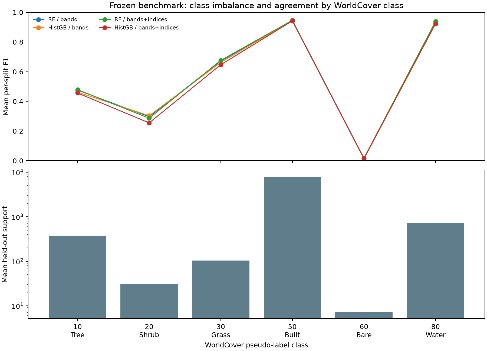
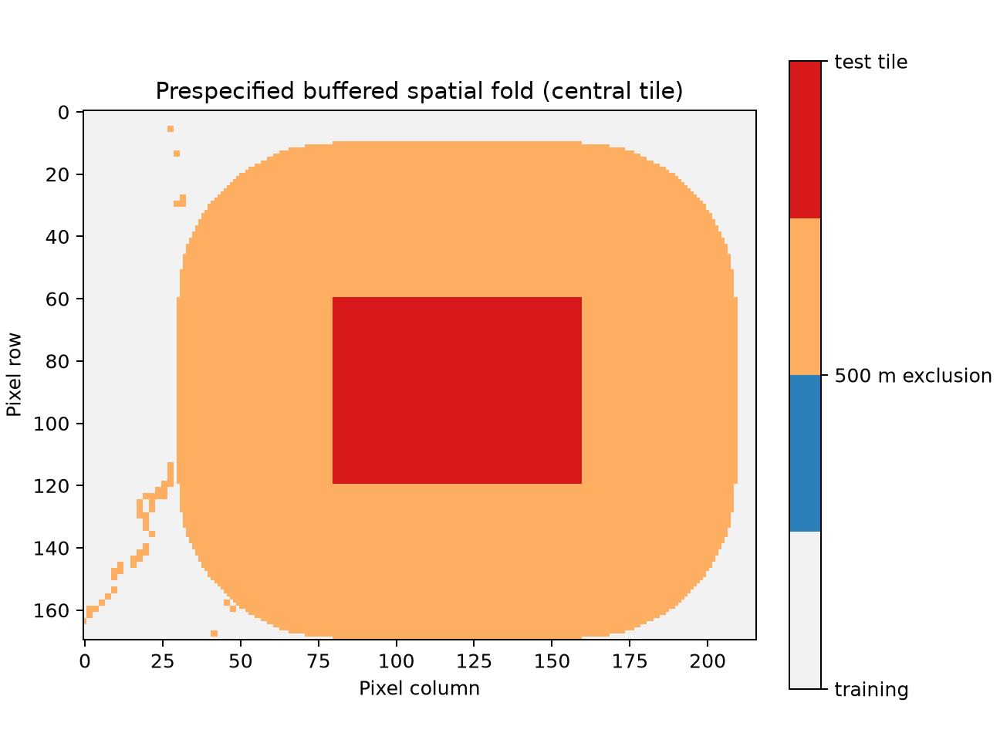
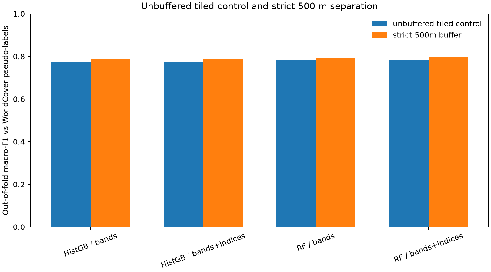
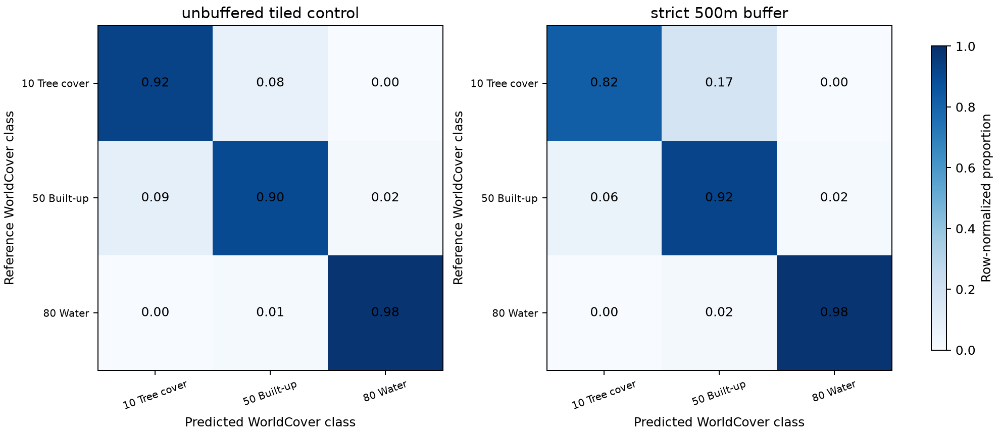

# GeoAI error analysis and buffered spatial robustness

## Research question and evidence boundary

This secondary study asks how class imbalance and short train/test distances affect the
project's apparent agreement with ESA WorldCover 2021. It does not replace the frozen GeoAI
benchmark in `results/geoai`, and it is not an independent land-cover accuracy assessment.
WorldCover is a historic pseudo-label product derived partly from remotely sensed inputs; it is
not field-survey ground truth.

The analysis uses the existing real Sentinel-2 L2A stack in EPSG:32636 and the aligned
WorldCover raster. Contains modified Copernicus Sentinel data 2021. © ESA WorldCover project
2021 / Contains modified Copernicus Sentinel data (2021) processed by the ESA WorldCover
consortium; WorldCover 2021 is provided under CC BY 4.0.

## Frozen-benchmark error analysis

The original three repeated group-disjoint holdouts remain unchanged. Metrics below are
recalculated from their stored confusion counts. The same held-out pixels can occur in more than
one repeat, so repeats are descriptive paired evaluations, not independent observations.

| Model | Features | Macro-F1 | Weighted-F1 | Balanced accuracy |
|---|---|---:|---:|---:|
| Random Forest | Bands | 0.5572 | 0.9211 | 0.6558 |
| Random Forest | Bands + NDVI/NDBI | 0.5573 | 0.9220 | 0.6489 |
| Histogram gradient boosting | Bands | 0.5516 | 0.9176 | 0.6481 |
| Histogram gradient boosting | Bands + NDVI/NDBI | 0.5398 | 0.9158 | 0.6295 |

Mean held-out support per repeat is dominated by built-up pixels (7,883 of 9,117; 86.47%).
The mean class-level F1 ranges across the four model/feature configurations show the resulting
disagreement between weighted and macro summaries:

| WorldCover pseudo-label | Mean support per repeat | Mean F1 range |
|---|---:|---:|
| Built-up | 7,883.3 | 0.9423–0.9464 |
| Water | 716.3 | 0.9231–0.9391 |
| Tree cover | 375.0 | 0.4564–0.4792 |
| Grassland | 104.0 | 0.6467–0.6764 |
| Shrubland | 31.0 | 0.2550–0.3033 |
| Bare / sparse vegetation | 7.3 | 0.0130–0.0169 |

A baseline chosen only from each training partition always predicts built-up. Across the three
unique splits it obtains accuracy 0.8517–0.8743 and weighted-F1 0.7835–0.8157, but macro-F1 only
0.1533–0.1555 and balanced accuracy exactly 1/6. This demonstrates why weighted scores alone
are not adequate evidence of minority-class agreement.

Adding NDVI/NDBI does not provide a consistent gain. Mean paired changes relative to bands only
are +0.0001 macro-F1 and −0.0069 balanced accuracy for Random Forest, and −0.0118 macro-F1 and
−0.0186 balanced accuracy for histogram gradient boosting. These indices are deterministic
ratios of bands already available to both tree models; the small mixed changes are descriptive,
not evidence of a general benefit or harm.

## Prespecified buffered protocol

The robustness experiment uses nine contiguous test tiles aligned to the original 20 × 20-pixel
group grid. The 9 block rows are partitioned 3/3/3, and the 11 block columns 4/4/3. Every valid
pixel is assigned to exactly one test tile. Training pixels must come from different original
groups and, in the buffered condition, their centres must be strictly more than 500 m from every
test-pixel centre.

The 500 m distance was fixed before any new model score was calculated. It is the largest member
of a prespecified 100, 200, 300, 400, 500 and 600 m feasibility sequence for which every fold
retains at least three training-supported classes. At 600 m one fold falls below that criterion.
The unbuffered tiled condition uses the same test targets and models, providing the direct
comparison; the original random grouped benchmark is retained only as historical context.

Class eligibility is derived exclusively from buffered training support. The intersection across
all nine folds is tree cover (10), built-up (50), and water (80). These fixed classes are used for
both distance conditions and every model/feature comparison. Other classes are reported as
geographically unsupported rather than silently filtered: among all valid pixels, shrubland has
76 pixels, grassland 137, cropland 2, bare/sparse vegetation 49, and wetland 1. Their localized
coverage cannot support a nine-fold 500 m generalization test in this AOI.

Models and numerical settings are inherited from the frozen benchmark: Random Forest and
histogram gradient boosting, each with bands-only and bands-plus-NDVI/NDBI inputs. Fold seeds are
fixed in the versioned configuration. Training subsampling, class selection, predictions,
skipped folds, low-support classes, and exact pixel-centre separation are recorded.
The five reflectance bands and pixelwise NDVI/NDBI calculations require no fitted global
preprocessor; every model is fitted only on its fold's training indices. Held-out features enter
only prediction, and held-out labels enter only support diagnostics and post-fit scoring.

## Completed secondary experiment

The prespecified run completed for all nine tiles and all four model/feature combinations. Both
conditions evaluate the same 36,193 pixels from the same three fixed classes exactly once. The
unbuffered condition has a measured minimum train/test pixel-centre distance of 10.0 m; the
buffered minimum is 500.10 m in every fold. No original group ID crosses a train/test boundary.

| Model | Features | Macro-F1 0 m | Macro-F1 500 m | Δ | Weighted-F1 0 m | Weighted-F1 500 m | Δ balanced accuracy |
|---|---|---:|---:|---:|---:|---:|---:|
| Random Forest | Bands | 0.7818 | 0.7927 | +0.0109 | 0.9265 | 0.9350 | −0.0248 |
| Random Forest | Bands + NDVI/NDBI | 0.7829 | 0.7955 | +0.0127 | 0.9267 | 0.9364 | −0.0266 |
| Histogram gradient boosting | Bands | 0.7756 | 0.7863 | +0.0108 | 0.9230 | 0.9331 | −0.0314 |
| Histogram gradient boosting | Bands + NDVI/NDBI | 0.7733 | 0.7896 | +0.0163 | 0.9223 | 0.9338 | −0.0227 |

The macro- and weighted-F1 increases do not imply uniformly better class behavior. Balanced
accuracy falls for every configuration because tree-cover recall decreases, while built-up
recall and tree-cover precision improve. For the pre-existing Random Forest + indices
configuration used in the confusion figure—not selected from the secondary scores—the aggregate
class metrics are:

| Condition | Class | Support | Precision | Recall | F1 |
|---|---|---:|---:|---:|---:|
| 0 m | Tree cover | 1,253 | 0.3071 | 0.9242 | 0.4610 |
| 0 m | Built-up | 30,074 | 0.9939 | 0.8975 | 0.9432 |
| 0 m | Water | 4,866 | 0.9085 | 0.9831 | 0.9443 |
| 500 m | Tree cover | 1,253 | 0.3463 | 0.8236 | 0.4876 |
| 500 m | Built-up | 30,074 | 0.9893 | 0.9204 | 0.9536 |
| 500 m | Water | 4,866 | 0.9121 | 0.9811 | 0.9453 |

Built-up still contributes 83.09% of the fixed-core evaluation pixels. The training-majority
baseline therefore obtains weighted-F1 0.7542 but macro-F1 0.3026 and balanced accuracy 1/3.
The robustness study excludes 265 otherwise valid pixels (0.73%) because their five classes do
not meet common buffered-training support: shrubland 76, grassland 137, cropland 2, bare/sparse
vegetation 49, and wetland 1. These are exclusions from this three-class target, not evidence that
the pixels or source labels are invalid.

Raw fixed-core training availability falls from a mean 32,172 pixels per fold at 0 m to 20,290 at
500 m; after the frozen class-wise cap, fitted training sizes average 3,488 and 3,171. Therefore
the paired change is the effect of enforcing geographic exclusion together with its unavoidable
change in training size and composition. Class eligibility and test targets do not change, but
the result cannot isolate distance from training-composition effects.

Tile-level macro-F1 is highly heterogeneous (0.331–0.835 for Random Forest + indices). Water is
absent from six of nine tiles; one tile has no tree-cover pixels and another has only two, which is
reported as low support rather than scored at class level. The paired macro-F1 change for that
configuration ranges from −0.0021 to +0.0331 across tiles. These tiles are spatial partitions of
one scene, not nine independent datasets, so no confidence interval or significance claim is
made.

Adding NDVI/NDBI remains a small, inconsistent effect: its macro-F1 change relative to bands only
ranges from −0.0023 (unbuffered HistGB) to +0.0032 (buffered HistGB). The experiment does not
support a general spectral-index gain.

### Relationship to the original study

| Evaluation | Target classes and sampling | Minimum separation | RF + indices macro-F1 | Weighted-F1 | Balanced accuracy |
|---|---|---:|---:|---:|---:|
| Frozen original | Six classes; three repeated grouped holdouts | 10.0 m | 0.5573 mean | 0.9220 mean | 0.6489 mean |
| Tiled control | Three fixed classes; every core pixel once | 10.0 m | 0.7829 | 0.9267 | 0.9349 |
| Buffered robustness | Same three classes and test pixels as tiled control | 500.10 m | 0.7955 | 0.9364 | 0.9084 |

Only the tiled-control versus buffered rows form a direct paired comparison. The much larger
macro-F1 difference from the original study is principally confounded by removal of three weak,
rare classes and a different holdout design; it is not evidence that the new protocol is more
accurate.

## Figures









Figure hashes, exact source-artifact hashes, and attribution are in the
[publication manifest](assets/geoai_spatial_validation/README.md).

## Provenance

- Real EO stack SHA-256: `c8ff16e6b5dee42af669ee3dde6efdf91437505b36fb33fd304781e0db606fb4`.
- EO provenance SHA-256: `0b2b93c0a7a64cc92cf291423dcf728cd3f6ad35df3898467adec54716c6938a`.
- Frozen original detail SHA-256: `6d59bf49c2b100a5c70043e168b4fa5a2b8b3707b58134d8fa0c42511f5ce76c`.
- Frozen original configuration SHA-256: `fc8e46e67a973dd6d835dc48b03c6efdae95ede45714b94421abb5374da1d3a6`.
- Secondary canonical configuration SHA-256: `08e45e79a687131f6116b0e36f4416f273a30fb31c97b41d540f4117ac62e45a`.
- Secondary bundle provenance SHA-256: `f61ed82ed29cc939e8b17efc670eec521b2cf80929db51595edd00de47b5e1d0`.
- Producing code revision: `4d6034224f59086d12a83fa8f0f91800754bb382` with a clean working tree.

## Reproduction and artifact isolation

The secondary experiment has its own configuration and ignored output directory:

```powershell
.\.venv\Scripts\urbantwin.exe geoai-spatial-validate
```

The command refuses to overwrite an existing output bundle. Its manifest binds the real input
stack, EO provenance, frozen benchmark details, versioned configuration snapshot, and generated
tables with SHA-256 hashes. Run the bundle validator before interpreting or publishing figures.
Compact figures may be tracked only with a source manifest and the Copernicus/WorldCover
acknowledgements above; large input rasters remain ignored.

To regenerate only the tracked figure renderings from an already validated local bundle, without
fitting any model, use:

```powershell
.\.venv\Scripts\urbantwin.exe geoai-spatial-figures `
  --output-dir "docs\assets\geoai_spatial_validation_reproduction"
```

## Interpretation limits

- The AOI is about 2.16 km × 1.70 km. A 500 m buffer tests local extrapolation within one compact
  urban scene, not transfer to an independent district, city, sensor date, or reference survey.
- Fixed core classes make the model comparison fair, but narrow the scientific target to three
  classes. The study cannot establish rare-class generalization.
- WorldCover and Sentinel-2 are temporally aligned to 2021 but are not statistically independent
  evidence sources. Agreement may reflect shared spatial or remote-sensing structure.
- Contiguous folds and distance exclusion reduce local leakage; they cannot remove scene-level
  autocorrelation or establish field accuracy.
- No buffer was selected using held-out performance. Buffer comparisons remain descriptive, and
  folds must not be treated as nine independent regional samples.

An external, legally reusable and temporally appropriate reference survey with documented class
definitions and sampling uncertainty would be required for independent accuracy validation.
None is included in this study.
